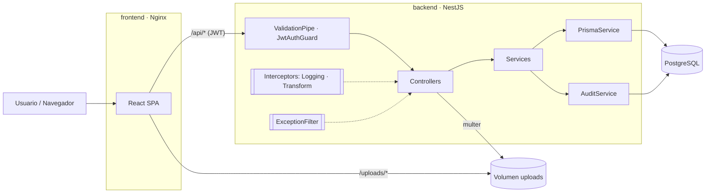
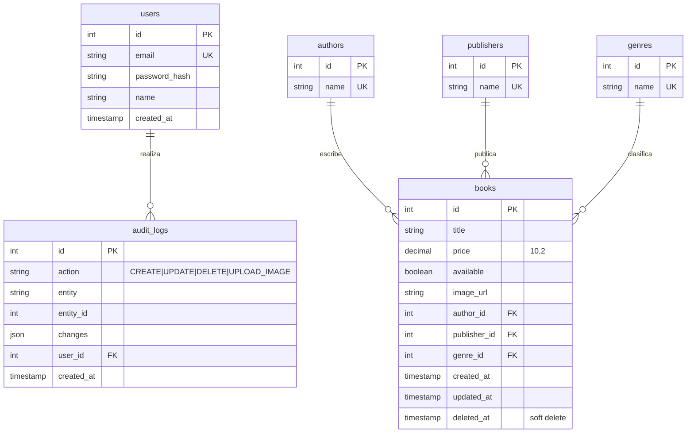

# CMPC-libros

Aplicación web para digitalizar el inventario de la tienda CMPC-libros.

| Capa | Tecnología |
|---|---|
| Frontend | React 19 + TypeScript + Vite, React Router, React Hook Form + Zod, Axios |
| Backend | NestJS 11 + TypeScript, Passport JWT, class-validator, Swagger |
| Base de datos | PostgreSQL 16 + Prisma ORM 6 (migraciones + cliente tipado) |
| Tests | Jest (backend), Vitest + Testing Library (frontend) |
| Despliegue | Docker Compose (Postgres + API + Nginx sirviendo el frontend) |

---

## 1. Instalación

### Opción A — Docker (recomendada)

Requisitos: Docker y Docker Compose.

```bash
git clone https://github.com/zmykedev/cmpc-libros.git
cd cmpc-libros
docker compose up -d --build
```

La primera vez tarda unos minutos. El orden de arranque está controlado por healthchecks: Postgres → API (migraciones + datos de ejemplo) → frontend. Para ver el avance: `docker compose ps` o `docker compose logs -f backend`.

| Servicio | URL |
|---|---|
| Aplicación | http://localhost:8080 |
| API | http://localhost:3000/api |
| Swagger | http://localhost:3000/api/docs |

Al arrancar, el backend aplica las migraciones y carga datos de ejemplo (15 libros) y el usuario:

```
Usuario:    admin@cmpc.cl
Contraseña: admin123
```

La pantalla de login muestra estas credenciales y tiene un botón que completa el formulario. La prueba pide login con JWT, no registro de usuarios; un alta de usuarios con roles está entre las mejoras para producción (sección 5).

Comandos útiles:

| Acción | Comando |
|---|---|
| Detener | `docker compose down` |
| Detener y borrar datos (base e imágenes subidas) | `docker compose down -v` |
| Reconstruir tras cambios de código | `docker compose up -d --build` |

**Configuración opcional:** copia `.env.example` a `.env` para cambiar el secreto JWT, las credenciales de Postgres o los puertos (`API_PORT`, `WEB_PORT`) si el 3000 o el 8080 ya están ocupados en tu máquina.

### Opción B — Local sin Docker

Requisitos: Node 22+, PostgreSQL 16 corriendo en `localhost:5432`.

```bash
# Backend
cd backend
cp .env.example .env          # ajusta DATABASE_URL si es necesario
npm install
npx prisma migrate dev        # crea las tablas
npx prisma db seed            # usuario admin + libros de ejemplo
npm run start:dev             # http://localhost:3000/api

# Frontend (otra terminal)
cd frontend
npm install
npm run dev                   # http://localhost:5173 (proxy /api → :3000)
```

### Tests y cobertura

```bash
cd backend  && npm run test:cov   # 38 tests — ~99% líneas
cd frontend && npm run test:cov   # 39 tests — ~100% líneas
```

Ambos proyectos tienen un umbral mínimo de 80% configurado: si la cobertura baja, el comando falla.

---

## 2. Guía de uso

1. **Login**: ingresa con `admin@cmpc.cl / admin123`. La sesión dura 8 h; si el token expira, la app vuelve al login automáticamente.
2. **Inventario** (pantalla principal):
   - **Búsqueda** por título o autor mientras escribes (debounce de 400 ms: sólo se consulta cuando dejas de escribir).
   - **Filtros** por género, editorial, autor y disponibilidad. *Limpiar* los quita todos.
   - **Orden múltiple**: haz clic en el encabezado de una columna (▲ asc → ▼ desc → sin orden). Puedes combinar varias columnas; el número junto a la flecha indica la prioridad.
   - **Paginación** en el servidor (10 por página).
   - **Exportar CSV** descarga los libros que cumplen los filtros/orden actuales (sin paginar).
3. **Nuevo libro / Editar**: los errores se muestran mientras escribes y *Guardar* se habilita sólo cuando el formulario es válido. Autor, editorial y género sugieren valores existentes; si escribes uno nuevo, se crea. Imagen opcional (jpg/png/webp, máx. 2 MB) con vista previa.
4. **Detalle**: clic en un título para ver todos sus datos, editarlo o eliminarlo (eliminación lógica).

---

## 3. Arquitectura



Nginx sirve el build del frontend y hace de proxy de `/api` y `/uploads` hacia el backend, así el navegador ve un único origen (sin CORS en producción).

### Backend (`backend/src`)

```
main.ts                  bootstrap: prefijo /api, ValidationPipe, filtro, interceptores, Swagger
app.module.ts
prisma/                  PrismaService (módulo global)
audit/                   AuditService: escribe audit_logs dentro de la transacción recibida
auth/                    login, JwtStrategy, JwtAuthGuard
books/
  books.controller.ts    endpoints REST (sólo HTTP: valida, extrae usuario, delega)
  books.service.ts       reglas de negocio + transacciones
  book-query.builder.ts  funciones puras: filtros → WHERE, "campo:dir,…" → ORDER BY
  csv.util.ts            serialización CSV (RFC 4180 + anti-inyección de fórmulas)
  image-upload.ts        configuración de multer (tipo, tamaño, nombre aleatorio)
  dto/                   DTOs con class-validator + Swagger
common/
  interceptors/          TransformInterceptor, LoggingInterceptor
  filters/               HttpExceptionFilter (incluye errores de Prisma)
  decorators/            @CurrentUser()
```

**Endpoints** (todos bajo `/api`, documentados en Swagger):

| Método | Ruta | Descripción |
|---|---|---|
| POST | `/auth/login` | Devuelve `accessToken` JWT |
| GET | `/books` | Listado: `page, limit, search, genreId, publisherId, authorId, available, sort` |
| GET | `/books/:id` | Detalle |
| POST | `/books` | Crear |
| PATCH | `/books/:id` | Actualizar parcial |
| DELETE | `/books/:id` | Soft delete |
| POST | `/books/:id/image` | Subir imagen (`multipart/form-data`, campo `file`) |
| GET | `/books/export` | CSV con los mismos filtros/orden del listado |
| GET | `/genres`, `/publishers`, `/authors` | Catálogos para los filtros |

`sort` acepta varios campos: `?sort=genre:asc,price:desc`. Campos válidos: `title, price, createdAt, available, author, publisher, genre`.

**Formato de respuesta** (aplicado por `TransformInterceptor` y `HttpExceptionFilter`):

```json
{ "success": true,  "data": { ... }, "timestamp": "..." }
{ "success": false, "statusCode": 404, "message": "Libro 9 no encontrado", "path": "/api/books/9", "timestamp": "..." }
```

### Frontend (`frontend/src`)

```
api/client.ts       instancia Axios: agrega Bearer, desempaqueta {data}, en 401 cierra sesión, errorMessage()
api/books.ts        tipos + funciones por endpoint
auth/               AuthContext (token en localStorage) y ProtectedRoute
hooks/useDebounce   debounce genérico
utils/sort.ts       lógica de orden múltiple (pura y testeada)
components/         BookTable, BookFilters, Pagination, Field, Alert, Layout
pages/              Login, Books (listado), BookForm (alta/edición), BookDetail
```

---

## 4. Modelo de datos



El esquema fuente está en [`backend/prisma/schema.prisma`](backend/prisma/schema.prisma) y la versión para dbdiagram.io en [`docs/database.dbml`](docs/database.dbml).

**Índices** (pensados para el listado):

| Índice | Motivo |
|---|---|
| `books(deleted_at, title)` | Toda consulta filtra `deleted_at IS NULL`; además sirve para ordenar por título |
| `books(author_id)`, `(publisher_id)`, `(genre_id)` | Filtros y joins por FK (Postgres no indexa FKs automáticamente) |
| `books(available)`, `books(price)` | Filtro de disponibilidad y orden por precio |
| `authors/publishers/genres(name)` UNIQUE | Evita duplicados y acelera el `connectOrCreate` por nombre |
| `audit_logs(entity, entity_id)`, `(created_at)` | Consultar el historial de un registro o por fecha |

---

## 5. Decisiones de diseño

- **Normalización**: autor, editorial y género son tablas propias (3FN). El cliente envía *nombres* y el backend hace `connectOrCreate`, así el formulario es simple y no se duplican valores.
- **Transacciones**: crear, editar, eliminar y subir imagen se ejecutan con `prisma.$transaction(async tx => …)`. El cambio y su registro de auditoría se confirman juntos o ninguno. El listado usa una transacción en lote para que `items` y `total` sean consistentes.
- **Soft delete**: `DELETE` sólo marca `deleted_at`. `buildBookWhere` siempre agrega `deletedAt: null`, por lo que no hay forma de que un libro eliminado se cuele en listados, detalle, edición o CSV.
- **Auditoría**: doble nivel. `audit_logs` guarda quién hizo qué y los cambios (antes/después en updates). `LoggingInterceptor` registra cada request con usuario y duración en stdout (recolectable por Docker/CloudWatch/etc.).
- **SOLID**:
  - *S*: controlador = HTTP; servicio = negocio; query builder y CSV = funciones puras.
  - *O*: nuevos filtros/campos de orden se agregan en el builder y el DTO sin tocar el servicio.
  - *D*: los servicios reciben `PrismaService`/`AuditService` por inyección, lo que permite testearlos con dobles.
- **Validación en ambos lados**: DTOs con `class-validator` (`whitelist` + `forbidNonWhitelisted`) en la API; Zod con `mode: 'onChange'` en el frontend.
- **Orden estable**: siempre se agrega `id` como desempate para que la paginación no repita ni salte filas.
- **Imágenes**: se guardan en disco (volumen Docker) con nombre UUID; se valida tipo MIME y tamaño (2 MB) en front y back.
- **CSV**: con BOM UTF-8 (Excel muestra bien tildes/ñ) y escape de celdas que empiezan con `= + - @` para evitar inyección de fórmulas.

### Supuestos

- "Disponibilidad" se modela como booleano (disponible / agotado). Si se necesitara stock, sería un `stock INT` y `available` pasaría a ser derivado (`stock > 0`).
- Un libro tiene un único autor, editorial y género. Varios autores requeriría una tabla intermedia `book_authors`.
- Hay un solo rol (administrador); todos los usuarios autenticados pueden gestionar el inventario.
- Precios en CLP.

### Qué agregaría para producción (no implementado por alcance)

| Tema | Cómo lo implementaría |
|---|---|
| Roles | Columna `role` en `users`, decorador `@Roles()` + `RolesGuard` |
| Refresh tokens | Token de acceso corto (15 min) + refresh en cookie `httpOnly` rotado en tabla `refresh_tokens` |
| Imágenes | Interfaz `StorageService` con implementación S3/GCS (inyectada); el servicio no cambia |
| Seguridad HTTP | `helmet`, `@nestjs/throttler` en `/auth/login` |
| Restaurar eliminados | `PATCH /books/:id/restore` que pone `deleted_at = NULL` y audita |
| Tests e2e | Supertest contra Postgres en contenedor + Playwright para el frontend |
| Observabilidad | Logger JSON (pino) con request-id, health check `/api/health` con `@nestjs/terminus` |
| CI | GitHub Actions: lint, tests con cobertura, build de imágenes |
